# Diagrama de Casos de Uso UML — Sistema de Gestión de Finanzas (SIG)

> Documento generado automáticamente a partir del análisis de endpoints del backend y componentes del frontend.
> Última actualización: 19 de noviembre de 2026.

---

## Diagrama de Casos de Uso

```mermaid
flowchart LR
    %% ═══════════════════════════════════════════
    %% ACTOR
    %% ═══════════════════════════════════════════
    Actor["👤 Usuario"]

    %% ═══════════════════════════════════════════
    %% LÍMITE DEL SISTEMA
    %% ═══════════════════════════════════════════
    subgraph SIG["🏦 Sistema de Gestión de Finanzas — SIG"]
        direction TB

        subgraph MOD_AUTH["Módulo de Autenticación"]
            direction TB
            CU01["CU-01: Registrar usuario"]
            CU02["CU-02: Iniciar sesión con email/password"]
            CU03["CU-03: Iniciar sesión con Google OAuth"]
            CU04["CU-04: Cerrar sesión"]
        end

        subgraph MOD_CUENTAS["Módulo de Gestión de Cuentas"]
            direction TB
            CU05["CU-05: Crear cuenta financiera"]
            CU06["CU-06: Listar cuentas"]
            CU07["CU-07: Actualizar saldo de cuenta"]
            CU08["CU-08: Eliminar cuenta"]
            CU09["CU-09: Conversión bimonetaria de saldo"]
        end

        subgraph MOD_PRESUPUESTO["Módulo de Presupuesto Mensual"]
            direction TB
            CU10["CU-10: Registrar ingresos"]
            CU11["CU-11: Registrar gastos"]
            CU12["CU-12: Registrar inversiones"]
            CU13["CU-13: Calcular flujo de caja neto"]
            CU14["CU-14: Guardar presupuesto completo"]
            CU15["CU-15: Cargar presupuesto existente"]
        end

        subgraph MOD_DASHBOARD["Módulo de Dashboard y Visualización"]
            direction TB
            CU16["CU-16: Ver distribución de activos"]
            CU17["CU-17: Ver rendimiento mensual"]
            CU18["CU-18: Configurar objetivo anual"]
            CU19["CU-19: Ver progreso hacia objetivo anual"]
        end

        subgraph MOD_HISTORICO["Módulo de Evolución Histórica"]
            direction TB
            CU20["CU-20: Registrar cierre mensual"]
            CU21["CU-21: Ver gráfico de evolución patrimonial"]
        end

        subgraph MOD_ESTIMADOS["Módulo de Presupuestos Estimados"]
            direction TB
            CU22["CU-22: Crear presupuesto estimado"]
            CU23["CU-23: Listar presupuestos estimados"]
        end

        subgraph MOD_LANDING["Módulo de Landing Page"]
            direction TB
            CU24["CU-24: Ver página de inicio pública"]
            CU25["CU-25: Navegar a secciones informativas"]
        end
    end

    %% ═══════════════════════════════════════════
    %% CONEXIONES ACTOR → CASOS DE USO
    %% ═══════════════════════════════════════════
    Actor --> CU01
    Actor --> CU02
    Actor --> CU03
    Actor --> CU04
    Actor --> CU05
    Actor --> CU06
    Actor --> CU07
    Actor --> CU08
    Actor --> CU09
    Actor --> CU10
    Actor --> CU11
    Actor --> CU12
    Actor --> CU13
    Actor --> CU14
    Actor --> CU15
    Actor --> CU16
    Actor --> CU17
    Actor --> CU18
    Actor --> CU19
    Actor --> CU20
    Actor --> CU21
    Actor --> CU22
    Actor --> CU23
    Actor --> CU24
    Actor --> CU25
```

---

## Tabla Resumen de Casos de Uso

### Módulo de Autenticación

| ID | Nombre | Actor | Precondiciones | Flujo Principal |
|---|---|---|---|---|
| **CU-01** | Registrar usuario | Usuario | No estar registrado en el sistema. | El usuario ingresa nombre, email y password → el backend valida unicidad del email → encripta la contraseña con BCrypt → persiste el `Usuario` → genera un JWT → retorna `AuthResponse(token, email)`. |
| **CU-02** | Iniciar sesión con email/password | Usuario | Tener cuenta registrada. | El usuario envía email y password → `AuthenticationManager` valida credenciales → `JwtService` genera un token JWT (24 h) → retorna `AuthResponse`. El frontend almacena el token en `localStorage`. |
| **CU-03** | Iniciar sesión con Google OAuth | Usuario | Tener cuenta de Google válida. Tener configurado `GOOGLE_CLIENT_ID`. | El frontend muestra el botón `GoogleLogin` → Google devuelve un ID Token → el frontend envía el token a `POST /api/auth/google` → el backend verifica el token con `GoogleIdTokenVerifier` → busca o crea el usuario en la BD → genera un JWT → retorna `AuthResponse`. |
| **CU-04** | Cerrar sesión | Usuario | Tener sesión activa. | El usuario hace clic en "Cerrar sesión" desde el `MenuUsuario` → el frontend elimina `token` y `usuario` de `localStorage` → redirige a la Landing Page (`/`). |

### Módulo de Gestión de Cuentas

| ID | Nombre | Actor | Precondiciones | Flujo Principal |
|---|---|---|---|---|
| **CU-05** | Crear cuenta financiera | Usuario | Sesión activa (JWT válido). | El usuario completa el `FormularioCuenta` (nombre, tipo, moneda, monto, cotización opcional) → el frontend calcula `saldoActual = montoOriginal × cotización` → `POST /api/cuentas` → el backend persiste la `Cuenta` → el Dashboard se actualiza. |
| **CU-06** | Listar cuentas | Usuario | Sesión activa. | Al cargar el Dashboard, el frontend ejecuta `GET /api/cuentas` → el backend retorna `List<Cuenta>` → se renderizan en `TablaCuentas` y `GraficoCuentas`. |
| **CU-07** | Actualizar saldo de cuenta | Usuario | Sesión activa. Cuenta existente. | El usuario edita el monto y/o cotización en la `TablaCuentas` → clic en "Guardar Todos los Cambios" → por cada cuenta se ejecuta `PUT /api/cuentas/{id}` con el nuevo `saldoActual` calculado. |
| **CU-08** | Eliminar cuenta | Usuario | Sesión activa. Cuenta existente. | El usuario hace clic en "Eliminar" en una fila de `TablaCuentas` → confirmación por `window.confirm` → `DELETE /api/cuentas/{id}` → la cuenta desaparece del listado. |
| **CU-09** | Conversión bimonetaria de saldo | Usuario | Sesión activa. | Al crear o actualizar una cuenta, si la moneda es USD u Otro, el frontend muestra un campo de cotización. El saldo final se calcula como `montoOriginal × cotización` antes de enviarse al backend. |

### Módulo de Presupuesto Mensual

| ID | Nombre | Actor | Precondiciones | Flujo Principal |
|---|---|---|---|---|
| **CU-10** | Registrar ingresos | Usuario | Sesión activa. | En la vista `/presupuesto`, el usuario agrega filas de ingreso (nombre, moneda, monto, cotización) → se calcula el total de ingresos en tiempo real → los datos se envían como parte del presupuesto completo al guardar. |
| **CU-11** | Registrar gastos | Usuario | Sesión activa. | Mismo flujo que CU-10, pero las filas se marcan con tipo `GASTO`. |
| **CU-12** | Registrar inversiones | Usuario | Sesión activa. | Mismo flujo que CU-10, pero las filas se marcan con tipo `INVERSION` y la moneda por defecto es USD. |
| **CU-13** | Calcular flujo de caja neto | Usuario | Sesión activa. Al menos un movimiento registrado. | El frontend calcula en tiempo real: `Flujo de Caja = Σ(Ingresos) − Σ(Gastos) − Σ(Inversiones)`, donde cada suma convierte a ARS con `montoOriginal × cotización`. Se muestra con color verde (positivo) o rojo (negativo). |
| **CU-14** | Guardar presupuesto completo | Usuario | Sesión activa. | El usuario hace clic en "Guardar Presupuesto" → el frontend recopila todas las filas de ingresos, gastos e inversiones → `POST /api/presupuesto/guardar-todo` → el backend ejecuta `deleteAll()` + `saveAll()` atómicamente. |
| **CU-15** | Cargar presupuesto existente | Usuario | Sesión activa. | Al navegar a `/presupuesto`, el `useEffect` ejecuta `GET /api/presupuesto` → el backend retorna `List<MovimientoPresupuesto>` → el frontend filtra por tipo (`INGRESO`, `GASTO`, `INVERSION`) y puebla las tablas. |

### Módulo de Dashboard y Visualización

| ID | Nombre | Actor | Precondiciones | Flujo Principal |
|---|---|---|---|---|
| **CU-16** | Ver distribución de activos | Usuario | Sesión activa. Al menos una cuenta existente. | El componente `GraficoCuentas` ejecuta `GET /api/cuentas` → transforma los datos al formato `{nombre, valor}` → renderiza un gráfico de torta (`PieChart` de Recharts) con las proporciones de cada cuenta. |
| **CU-17** | Ver rendimiento mensual | Usuario | Sesión activa. Al menos un registro histórico. | El componente `ResumenFinanciero` ejecuta `GET /api/cuentas` (saldo actual) y `GET /api/historico` (último cierre) → calcula `Rendimiento = saldoActual − saldoÚltimoMes` → lo muestra con color verde/rojo. |
| **CU-18** | Configurar objetivo anual | Usuario | Sesión activa. | En el panel "Objetivo Anual" de `ResumenFinanciero`, el usuario hace clic en "Editar" → ingresa el nuevo monto → clic en "OK" → se guarda en `localStorage` del navegador. Valor por defecto: \$200.000. |
| **CU-19** | Ver progreso hacia objetivo anual | Usuario | Sesión activa. | El componente `ResumenFinanciero` calcula `porcentaje = (saldoActual / objetivoAnual) × 100` → renderiza una barra de progreso con color dinámico (rojo < 60%, naranja < 100%, verde ≥ 100%). |

### Módulo de Evolución Histórica

| ID | Nombre | Actor | Precondiciones | Flujo Principal |
|---|---|---|---|---|
| **CU-20** | Registrar cierre mensual | Usuario | Sesión activa. | El usuario hace clic en "+ Agregar mes" en `EvolucionHistorica` → se abre un modal con mes, año y monto (prellenado con el saldo actual) → el usuario confirma → `POST /api/historico` → el backend persiste el `HistoricoMensual` → el gráfico se actualiza sin recargar la página. |
| **CU-21** | Ver gráfico de evolución patrimonial | Usuario | Sesión activa. Al menos un registro histórico. | El componente `EvolucionHistorica` ejecuta `GET /api/historico` → ordena cronológicamente por `anio`/`mes` → renderiza un gráfico de línea (`LineChart` de Recharts) con tooltip formateado en pesos. |

### Módulo de Presupuestos Estimados

| ID | Nombre | Actor | Precondiciones | Flujo Principal |
|---|---|---|---|---|
| **CU-22** | Crear presupuesto estimado | Usuario | Sesión activa. | El usuario envía los datos del presupuesto estimado (descripción, monto, tipo, multiplicador mensual) → `POST /api/presupuestos` → el backend persiste el `PresupuestoEstimado`. |
| **CU-23** | Listar presupuestos estimados | Usuario | Sesión activa. | Se ejecuta `GET /api/presupuestos` → el backend retorna `List<PresupuestoEstimado>` para su visualización. |

### Módulo de Landing Page

| ID | Nombre | Actor | Precondiciones | Flujo Principal |
|---|---|---|---|---|
| **CU-24** | Ver página de inicio pública | Usuario | Ninguna. | El usuario accede a `/` → se renderiza `LandingPage` con la animación ASCII, el hero con CTA "Comenzar", la sección Features, About y Footer. No requiere autenticación. |
| **CU-25** | Navegar a secciones informativas | Usuario | Ninguna. | Desde la Landing, el usuario navega con el `LandingNavbar` a las secciones `#features` y `#about` (scroll), o a rutas protegidas (`/dashboard`, `/presupuesto`) que redirigen a login si no hay sesión. |

---

## Mapa de Endpoints REST del Backend

| Método | Ruta | Controlador | Acceso | Descripción |
|---|---|---|---|---|
| `POST` | `/api/auth/registro` | `AuthController` | 🔓 Público | Registro de usuario nuevo |
| `POST` | `/api/auth/login` | `AuthController` | 🔓 Público | Login tradicional (email/password) |
| `POST` | `/api/auth/google` | `AuthController` | 🔓 Público | Login con Google OAuth |
| `GET` | `/api/cuentas` | `CuentaController` | 🔒 Autenticado | Listar todas las cuentas |
| `POST` | `/api/cuentas` | `CuentaController` | 🔒 Autenticado | Crear nueva cuenta |
| `PUT` | `/api/cuentas/{id}` | `CuentaController` | 🔒 Autenticado | Actualizar saldo de una cuenta |
| `DELETE` | `/api/cuentas/{id}` | `CuentaController` | 🔒 Autenticado | Eliminar una cuenta |
| `GET` | `/api/presupuesto` | `PresupuestoController` | 🔒 Autenticado | Obtener presupuesto completo |
| `POST` | `/api/presupuesto/guardar-todo` | `PresupuestoController` | 🔒 Autenticado | Reemplazar presupuesto completo |
| `GET` | `/api/historico` | `HistoricoMensualController` | 🔒 Autenticado | Obtener todos los registros históricos |
| `POST` | `/api/historico` | `HistoricoMensualController` | 🔒 Autenticado | Crear registro de cierre mensual |
| `GET` | `/api/presupuestos` | `PresupuestoEstimadoController` | 🔒 Autenticado | Listar presupuestos estimados |
| `POST` | `/api/presupuestos` | `PresupuestoEstimadoController` | 🔒 Autenticado | Crear presupuesto estimado |

---

## Mapa de Rutas del Frontend

| Ruta | Componente | Protegida | Descripción |
|---|---|---|---|
| `/` | `LandingPage` | ❌ | Página de inicio pública con hero, features, about y footer. |
| `/login` | `Login` | ❌ | Pantalla de inicio de sesión con Google OAuth. Redirige a `/dashboard` si ya hay sesión. |
| `/dashboard` | `Dashboard` → (`GraficoCuentas`, `ResumenFinanciero`, `EvolucionHistorica`, `FormularioCuenta`, `TablaCuentas`) | ✅ | Panel principal con gestión de cuentas, gráficos y evolución. |
| `/presupuesto` | `Presupuesto` | ✅ | Planificación mensual con ingresos, gastos, inversiones y flujo de caja. |
