# Diagrama de Clases UML — Sistema de Gestión de Finanzas (SIG)

> Documento generado automáticamente a partir del análisis del código fuente.
> Última actualización: 19 de noviembre de 2026.

---

## Diagrama de Clases

```mermaid
classDiagram
    direction TB

    %% ═══════════════════════════════════════════
    %% CAPA DE MODELO (Entidades JPA)
    %% ═══════════════════════════════════════════

    class Usuario {
        <<Entity · tabla: usuarios>>
        -Long id
        -String nombre
        -String email
        -String password
        -String googleId
        +getId() Long
        +setId(Long) void
        +getNombre() String
        +setNombre(String) void
        +getEmail() String
        +setEmail(String) void
        +getPassword() String
        +setPassword(String) void
        +getGoogleId() String
        +setGoogleId(String) void
        +getUsername() String
        +getAuthorities() Collection
        +isAccountNonExpired() boolean
        +isAccountNonLocked() boolean
        +isCredentialsNonExpired() boolean
        +isEnabled() boolean
    }

    class UserDetails {
        <<interface · Spring Security>>
        +getUsername() String
        +getPassword() String
        +getAuthorities() Collection
        +isAccountNonExpired() boolean
        +isAccountNonLocked() boolean
        +isCredentialsNonExpired() boolean
        +isEnabled() boolean
    }

    UserDetails <|.. Usuario : implements

    class Cuenta {
        <<Entity · tabla: cuentas>>
        -Long id
        -String nombre
        -String tipo
        -BigDecimal saldoActual
        +getId() Long
        +setId(Long) void
        +getNombre() String
        +setNombre(String) void
        +getTipo() String
        +setTipo(String) void
        +getSaldoActual() BigDecimal
        +setSaldoActual(BigDecimal) void
    }

    class MovimientoPresupuesto {
        <<Entity · abstract · STI>>
        -Long id
        -String nombre
        -String moneda
        -Double montoOriginal
        -Double cotizacion
        +getId() Long
        +setId(Long) void
        +getNombre() String
        +setNombre(String) void
        +getMoneda() String
        +setMoneda(String) void
        +getMontoOriginal() Double
        +setMontoOriginal(Double) void
        +getCotizacion() Double
        +setCotizacion(Double) void
    }

    class Ingreso {
        <<Entity · discriminador: INGRESO>>
    }

    class Gasto {
        <<Entity · discriminador: GASTO>>
    }

    class Inversion {
        <<Entity · discriminador: INVERSION>>
    }

    MovimientoPresupuesto <|-- Ingreso : tipo_movimiento = INGRESO
    MovimientoPresupuesto <|-- Gasto : tipo_movimiento = GASTO
    MovimientoPresupuesto <|-- Inversion : tipo_movimiento = INVERSION

    class HistoricoMensual {
        <<Entity · tabla: historico_mensual>>
        -Long id
        -Integer mes
        -Integer anio
        -BigDecimal saldoTotal
        +getId() Long
        +setId(Long) void
        +getMes() Integer
        +setMes(Integer) void
        +getAnio() Integer
        +setAnio(Integer) void
        +getSaldoTotal() BigDecimal
        +setSaldoTotal(BigDecimal) void
    }

    class PresupuestoEstimado {
        <<Entity · tabla: presupuestos>>
        -Long id
        -String descripcion
        -BigDecimal monto
        -String tipo
        -Integer multiplicadorMensual
        +getId() Long
        +setId(Long) void
        +getDescripcion() String
        +setDescripcion(String) void
        +getMonto() BigDecimal
        +setMonto(BigDecimal) void
        +getTipo() String
        +setTipo(String) void
        +getMultiplicadorMensual() Integer
        +setMultiplicadorMensual(Integer) void
    }

    %% ═══════════════════════════════════════════
    %% CAPA DE DTOs
    %% ═══════════════════════════════════════════

    class LoginRequest {
        <<DTO>>
        -String email
        -String password
        +getEmail() String
        +getPassword() String
    }

    class RegisterRequest {
        <<DTO>>
        -String email
        -String password
        -String nombre
        +getEmail() String
        +getPassword() String
        +getNombre() String
    }

    class GoogleLoginRequest {
        <<DTO>>
        -String token
        +getToken() String
    }

    class AuthResponse {
        <<DTO>>
        -String token
        -String email
        +AuthResponse(String, String)
        +getToken() String
        +getEmail() String
    }

    %% ═══════════════════════════════════════════
    %% CAPA DE REPOSITORIOS
    %% ═══════════════════════════════════════════

    class JpaRepository~T, ID~ {
        <<interface · Spring Data>>
        +findAll() List~T~
        +findById(ID) Optional~T~
        +save(T) T
        +deleteById(ID) void
        +deleteAll() void
        +saveAll(Iterable~T~) List~T~
    }

    class UsuarioRepository {
        <<interface · @Repository>>
        +findByEmail(String) Optional~Usuario~
    }

    class CuentaRepository {
        <<interface · @Repository>>
    }

    class MovimientoPresupuestoRepository {
        <<interface · @Repository>>
    }

    class HistoricoMensualRepository {
        <<interface · @Repository>>
    }

    class PresupuestoEstimadoRepository {
        <<interface · @Repository>>
    }

    JpaRepository <|-- UsuarioRepository
    JpaRepository <|-- CuentaRepository
    JpaRepository <|-- MovimientoPresupuestoRepository
    JpaRepository <|-- HistoricoMensualRepository
    JpaRepository <|-- PresupuestoEstimadoRepository

    %% ═══════════════════════════════════════════
    %% CAPA DE SEGURIDAD (Servicios)
    %% ═══════════════════════════════════════════

    class JwtService {
        <<@Service>>
        -String secretKey
        +extractUsername(String) String
        +generateToken(UserDetails) String
        +generateToken(Map, UserDetails) String
        +isTokenValid(String, UserDetails) boolean
        -isTokenExpired(String) boolean
        -extractExpiration(String) Date
        -extractAllClaims(String) Claims
        -getSignInKey() Key
    }

    class UsuarioDetailsService {
        <<@Service>>
        -UsuarioRepository usuarioRepository
        +loadUserByUsername(String) UserDetails
    }

    class JwtAuthenticationFilter {
        <<@Component · OncePerRequestFilter>>
        -JwtService jwtService
        -UsuarioDetailsService usuarioDetailsService
        #shouldNotFilter(HttpServletRequest) boolean
        #doFilterInternal(HttpServletRequest, HttpServletResponse, FilterChain) void
    }

    class SecurityConfig {
        <<@Configuration · @EnableWebSecurity>>
        -JwtAuthenticationFilter jwtAuthFilter
        -UserDetailsService userDetailsService
        +securityFilterChain(HttpSecurity) SecurityFilterChain
        +authenticationProvider() AuthenticationProvider
        +authenticationManager(AuthenticationConfiguration) AuthenticationManager
        +passwordEncoder() PasswordEncoder
        +corsConfigurationSource() CorsConfigurationSource
    }

    %% ═══════════════════════════════════════════
    %% CAPA DE CONTROLADORES
    %% ═══════════════════════════════════════════

    class AuthController {
        <<@RestController · /api/auth>>
        -UsuarioRepository usuarioRepository
        -PasswordEncoder passwordEncoder
        -JwtService jwtService
        -AuthenticationManager authenticationManager
        -String googleClientId
        +registrar(RegisterRequest) ResponseEntity~AuthResponse~
        +login(LoginRequest) ResponseEntity~AuthResponse~
        +googleLogin(GoogleLoginRequest) ResponseEntity~AuthResponse~
    }

    class CuentaController {
        <<@RestController · /api/cuentas>>
        -CuentaRepository cuentaRepository
        +obtenerTodas() List~Cuenta~
        +crearCuenta(Cuenta) Cuenta
        +actualizarSaldo(Long, Cuenta) Cuenta
        +eliminarCuenta(Long) void
    }

    class PresupuestoController {
        <<@RestController · /api/presupuesto>>
        -MovimientoPresupuestoRepository repository
        +obtenerPresupuesto() List~MovimientoPresupuesto~
        +guardarPresupuestoCompleto(List~MovimientoPresupuesto~) void
    }

    class HistoricoMensualController {
        <<@RestController · /api/historico>>
        -HistoricoMensualRepository repository
        +obtenerTodos() List~HistoricoMensual~
        +crear(HistoricoMensual) HistoricoMensual
    }

    class PresupuestoEstimadoController {
        <<@RestController · /api/presupuestos>>
        -PresupuestoEstimadoRepository repository
        +obtenerTodos() List~PresupuestoEstimado~
        +crear(PresupuestoEstimado) PresupuestoEstimado
    }

    %% ═══════════════════════════════════════════
    %% RELACIONES DE DEPENDENCIA
    %% ═══════════════════════════════════════════

    UsuarioDetailsService --> UsuarioRepository : usa
    JwtAuthenticationFilter --> JwtService : valida tokens
    JwtAuthenticationFilter --> UsuarioDetailsService : carga usuario
    SecurityConfig --> JwtAuthenticationFilter : registra filtro
    AuthController --> UsuarioRepository : CRUD usuarios
    AuthController --> JwtService : genera tokens
    CuentaController --> CuentaRepository : CRUD cuentas
    PresupuestoController --> MovimientoPresupuestoRepository : CRUD movimientos
    HistoricoMensualController --> HistoricoMensualRepository : CRUD histórico
    PresupuestoEstimadoController --> PresupuestoEstimadoRepository : CRUD presupuestos

    %% ═══════════════════════════════════════════
    %% CARDINALIDADES REPOSITORIO ↔ ENTIDAD
    %% ═══════════════════════════════════════════

    UsuarioRepository "1" --> "0..*" Usuario : gestiona
    CuentaRepository "1" --> "0..*" Cuenta : gestiona
    MovimientoPresupuestoRepository "1" --> "0..*" MovimientoPresupuesto : gestiona
    HistoricoMensualRepository "1" --> "0..*" HistoricoMensual : gestiona
    PresupuestoEstimadoRepository "1" --> "0..*" PresupuestoEstimado : gestiona

    %% ═══════════════════════════════════════════
    %% DTOs usados por controladores
    %% ═══════════════════════════════════════════

    AuthController ..> LoginRequest : consume
    AuthController ..> RegisterRequest : consume
    AuthController ..> GoogleLoginRequest : consume
    AuthController ..> AuthResponse : produce
```

---

## Estrategia de Herencia — Single Table Inheritance (STI)

La jerarquía `MovimientoPresupuesto` → `Ingreso`, `Gasto`, `Inversion` utiliza **Single Table Inheritance** (`@Inheritance(strategy = InheritanceType.SINGLE_TABLE)`). Todas las subclases se persisten en **una misma tabla** con una columna discriminadora:

| Columna Discriminadora | Tipo | Valores posibles |
|---|---|---|
| `tipo_movimiento` | `STRING` | `INGRESO`, `GASTO`, `INVERSION` |

La deserialización JSON polimórfica se logra con `@JsonTypeInfo` / `@JsonSubTypes`, usando la propiedad `tipo` como discriminador en el payload HTTP.

---

## Descripción de Clases Principales

### Entidades del Modelo

| Clase | Tabla | Descripción |
|---|---|---|
| **`Usuario`** | `usuarios` | Representa al usuario del sistema. Implementa `UserDetails` de Spring Security para integrarse con el mecanismo de autenticación. Soporta login tradicional (email/password) y login con Google OAuth (`googleId`). La columna `password` es nullable para usuarios que ingresan exclusivamente vía Google. |
| **`Cuenta`** | `cuentas` | Modela una cuenta financiera del usuario (billetera virtual, plataforma de inversión, efectivo). Almacena el saldo actual en ARS ya convertido (`saldoActual` como `BigDecimal`). |
| **`MovimientoPresupuesto`** | *(tabla única STI)* | Clase abstracta que representa un movimiento dentro del presupuesto mensual. Tiene soporte bimonetario: registra la `moneda` original, el `montoOriginal` y la `cotizacion` para conversión a ARS. |
| **`Ingreso`** | — | Subclase concreta de `MovimientoPresupuesto` con discriminador `INGRESO`. No agrega atributos propios. |
| **`Gasto`** | — | Subclase concreta de `MovimientoPresupuesto` con discriminador `GASTO`. No agrega atributos propios. |
| **`Inversion`** | — | Subclase concreta de `MovimientoPresupuesto` con discriminador `INVERSION`. No agrega atributos propios. |
| **`HistoricoMensual`** | `historico_mensual` | Registro de cierre mensual que almacena el saldo total patrimonial para un `mes`/`anio` dado. Se utiliza para alimentar el gráfico de evolución histórica. |
| **`PresupuestoEstimado`** | `presupuestos` | Concepto estimado de presupuesto con su `monto`, `tipo` y un `multiplicadorMensual` para proyectar costos recurrentes. |

### DTOs (Data Transfer Objects)

| Clase | Dirección | Descripción |
|---|---|---|
| **`LoginRequest`** | Frontend → Backend | Contiene `email` y `password` para autenticación tradicional. |
| **`RegisterRequest`** | Frontend → Backend | Contiene `email`, `password` y `nombre` para registrar un nuevo usuario. |
| **`GoogleLoginRequest`** | Frontend → Backend | Contiene el `token` (ID Token) emitido por Google tras el consentimiento OAuth. |
| **`AuthResponse`** | Backend → Frontend | Devuelve el `token` JWT generado por el servidor y el `email` del usuario autenticado. |

### Repositorios

| Interfaz | Entidad | Métodos Personalizados |
|---|---|---|
| **`UsuarioRepository`** | `Usuario` | `findByEmail(String): Optional<Usuario>` |
| **`CuentaRepository`** | `Cuenta` | *(solo métodos heredados de JpaRepository)* |
| **`MovimientoPresupuestoRepository`** | `MovimientoPresupuesto` | *(solo métodos heredados de JpaRepository)* |
| **`HistoricoMensualRepository`** | `HistoricoMensual` | *(solo métodos heredados de JpaRepository)* |
| **`PresupuestoEstimadoRepository`** | `PresupuestoEstimado` | *(solo métodos heredados de JpaRepository)* |

### Controladores

| Clase | Base Path | Endpoints | Descripción |
|---|---|---|---|
| **`AuthController`** | `/api/auth` | `POST /registro`, `POST /login`, `POST /google` | Gestiona registro, login tradicional y login con Google OAuth. Genera tokens JWT. |
| **`CuentaController`** | `/api/cuentas` | `GET /`, `POST /`, `PUT /{id}`, `DELETE /{id}` | CRUD completo de cuentas financieras. |
| **`PresupuestoController`** | `/api/presupuesto` | `GET /`, `POST /guardar-todo` | Lectura y escritura atómica del presupuesto mensual (borra todo y reinserta). |
| **`HistoricoMensualController`** | `/api/historico` | `GET /`, `POST /` | Lectura de todos los registros históricos y creación de un nuevo cierre mensual. |
| **`PresupuestoEstimadoController`** | `/api/presupuestos` | `GET /`, `POST /` | Lectura y creación de presupuestos estimados. |

### Capa de Seguridad

| Clase | Tipo | Descripción |
|---|---|---|
| **`JwtService`** | `@Service` | Genera y valida tokens JWT (HS256, 24 h de expiración). La clave secreta se inyecta desde la variable de entorno `JWT_SECRET`. |
| **`UsuarioDetailsService`** | `@Service` | Implementa `UserDetailsService` de Spring Security. Busca al usuario por email en la base de datos. |
| **`JwtAuthenticationFilter`** | `@Component` | Filtro que intercepta cada request HTTP, extrae el Bearer token del header `Authorization`, lo valida con `JwtService` y establece el contexto de seguridad. Excluye las rutas `/api/auth/**` y requests `OPTIONS`. |
| **`SecurityConfig`** | `@Configuration` | Configura la cadena de seguridad: CORS (orígenes `localhost:5173`), CSRF deshabilitado, sesiones stateless, endpoints `/api/auth/**` públicos, todo el resto autenticado. Registra `BCryptPasswordEncoder` y el `JwtAuthenticationFilter`. |
