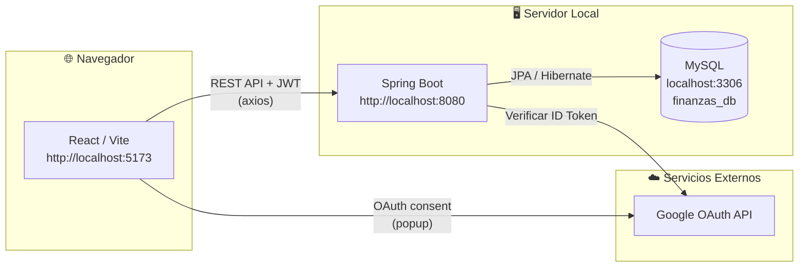
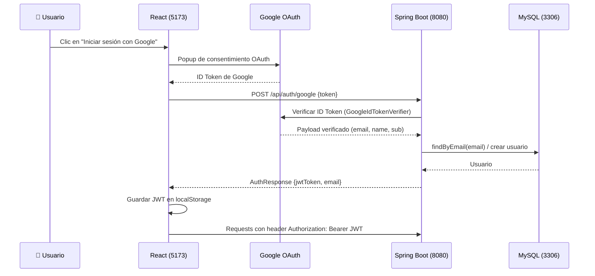

# Guía de Operación y Despliegue Local — Sistema de Gestión de Finanzas (SIG)
---

## 1. Requisitos Previos

| Componente | Versión Mínima | Notas |
|---|---|---|
| **JDK** | 17 | Requerido por `pom.xml` (`<java.version>17</java.version>`) y Spring Boot 4.1.1. |
| **Apache Maven** | 3.9+ | O usar el wrapper incluido (`./mvnw` / `mvnw.cmd`). |
| **Node.js** | 18+ | Requerido por Vite 8.x y React 19.x. |
| **npm** | 9+ | Viene incluido con Node.js. Se usa para instalar dependencias del frontend. |
| **MySQL** | 8.0+ | Motor de base de datos relacional. |
| **Git** | 2.x | Para clonar el repositorio. |

> [!TIP]
> Se recomienda usar un gestor de versiones como [SDKMAN!](https://sdkman.io/) para JDK y [nvm](https://github.com/nvm-sh/nvm) para Node.js.

---

## 2. Clonar el Repositorio

```bash
git clone https://github.com/santi-248/gestion-finanzas.git
cd gestion-finanzas
```

---

## 3. Configuración de la Base de Datos

### 3.1 Crear la base de datos

Conectarse a MySQL y ejecutar:

```sql
CREATE DATABASE IF NOT EXISTS finanzas_db
  CHARACTER SET utf8mb4
  COLLATE utf8mb4_unicode_ci;
```

> [!NOTE]
> La aplicación también crea la base automáticamente si no existe, gracias al parámetro `createDatabaseIfNotExist=true` en la URL de conexión.

### 3.2 Credenciales

La configuración de conexión se encuentra en `src/main/resources/application.properties`:

```properties
spring.datasource.url=jdbc:mysql://localhost:3306/finanzas_db?createDatabaseIfNotExist=true&serverTimezone=UTC
spring.datasource.username=TU_USUARIO_MYSQL
spring.datasource.password=TU_PASSWORD_MYSQL
```

> [!IMPORTANT]
> Las tablas se crean y actualizan automáticamente por Hibernate (`spring.jpa.hibernate.ddl-auto=update`). No es necesario ejecutar scripts DDL manualmente.

---

## 4. Configuración de Variables de Entorno

El proyecto utiliza la librería **spring-dotenv** para cargar variables desde un archivo `.env` en la raíz del proyecto.

### 4.1 Archivo `.env` (raíz del proyecto)

Crear el archivo `gestion-finanzas/.env` con el siguiente contenido:

```env
JWT_SECRET=TU_JWT_SECRET_BASE64
GOOGLE_CLIENT_ID=TU_GOOGLE_CLIENT_ID
```

| Variable | Descripción | Cómo obtenerla |
|---|---|---|
| `JWT_SECRET` | Clave secreta en Base64 para firmar tokens JWT (HS256). Mínimo 256 bits. | Generar con: `openssl rand -base64 32` |
| `GOOGLE_CLIENT_ID` | Client ID de Google OAuth 2.0. | Crear en [Google Cloud Console](https://console.cloud.google.com/apis/credentials) → Credenciales → ID de cliente OAuth 2.0. |

### 4.2 Archivo `.env` del frontend

Crear el archivo `gestion-finanzas/frontend/src/.env` con:

```env
VITE_GOOGLE_CLIENT_ID=TU_GOOGLE_CLIENT_ID
VITE_API_URL=http://localhost:8080/api
```

| Variable | Descripción |
|---|---|
| `VITE_GOOGLE_CLIENT_ID` | Mismo Client ID de Google configurado en el backend. |
| `VITE_API_URL` | URL base de la API del backend. Por defecto: `http://localhost:8080/api`. |

> [!CAUTION]
> Nunca subas los archivos `.env` con credenciales reales al repositorio. Asegúrate de que estén en `.gitignore`.

---

## 5. Levantar el Backend (Puerto 8080)

### 5.1 Instalar dependencias y compilar

```bash
# Desde la raíz del proyecto (gestion-finanzas/)
./mvnw clean install -DskipTests
```

En Windows:

```cmd
mvnw.cmd clean install -DskipTests
```

### 5.2 Ejecutar la aplicación

```bash
./mvnw spring-boot:run
```

En Windows:

```cmd
mvnw.cmd spring-boot:run
```

La aplicación Spring Boot arrancará en **http://localhost:8080**.

Logs esperados al arrancar correctamente:

```
Started FinanzasApplication in X.XXX seconds
Tomcat started on port 8080
```

> [!NOTE]
> El perfil activo por defecto es `local` (`spring.profiles.active=local`), que carga `application-local.properties` con las variables `JWT_SECRET` y `GOOGLE_CLIENT_ID`.

---

## 6. Levantar el Frontend (Puerto 5173)

### 6.1 Instalar dependencias

```bash
cd frontend
npm install
```

### 6.2 Ejecutar en modo desarrollo

```bash
npm run dev
```

La aplicación React/Vite arrancará en **http://localhost:5173**.

Salida esperada:

```
  VITE v8.x.x  ready in XXX ms

  ➜  Local:   http://localhost:5173/
  ➜  Network: use --host to expose
```

### 6.3 Dependencias principales del frontend

| Paquete | Versión | Propósito |
|---|---|---|
| `react` / `react-dom` | 19.2.x | Framework de UI |
| `react-router-dom` | 7.18.x | Enrutamiento SPA |
| `@react-oauth/google` | 0.13.x | Integración con Google OAuth |
| `axios` | 1.21.x | Cliente HTTP para consumir la API REST |
| `recharts` | 3.10.x | Gráficos (torta, línea) |
| `lucide-react` | 1.61.x | Íconos SVG |
| `vite` | 8.3.x | Build tool y dev server |

---

## 7. Arquitectura de Despliegue Local



### Flujo de autenticación



---

## 8. Verificación Operativa (Smoke Test)

Una vez que tanto el backend como el frontend estén corriendo, seguir estos pasos para verificar que todo funciona:

### 8.1 Verificar el backend

```bash
# 1. Health check — debe retornar 401 (el endpoint está protegido, lo cual confirma que Spring Security está activo)
curl -s -o /dev/null -w "%{http_code}" http://localhost:8080/api/cuentas
# Resultado esperado: 401

# 2. Endpoint público — debe retornar 400 (bad request por body vacío, pero confirma que la ruta existe)
curl -s -o /dev/null -w "%{http_code}" -X POST http://localhost:8080/api/auth/login -H "Content-Type: application/json" -d "{}"
# Resultado esperado: 400 o 500

# 3. Registrar un usuario de prueba
curl -s -X POST http://localhost:8080/api/auth/registro \
  -H "Content-Type: application/json" \
  -d '{"nombre":"Test","email":"test@test.com","password":"123456"}'
# Resultado esperado: 200 con JSON {"token":"eyJ...", "email":"test@test.com"}
```

### 8.2 Verificar el frontend

1. Abrir **http://localhost:5173** en el navegador.
2. Verificar que la **Landing Page** se renderiza correctamente con la animación ASCII y el botón "Comenzar".
3. Hacer clic en **"Comenzar"** → debe redirigir a `/login`.
4. Verificar que el botón de **"Iniciar sesión con Google"** aparece en la pantalla de login.
5. Iniciar sesión → debe redirigir a `/dashboard` con el gráfico de torta, panel de control y evolución histórica.

### 8.3 Verificar CORS

Si el frontend puede comunicarse con el backend sin errores de CORS, la configuración de `SecurityConfig.corsConfigurationSource()` está funcionando correctamente. Los orígenes permitidos son:

- `http://localhost:5173`
- `http://127.0.0.1:5173`

### 8.4 Verificar la base de datos

```sql
-- Conectarse a MySQL y verificar que las tablas fueron creadas automáticamente
USE finanzas_db;
SHOW TABLES;
-- Resultado esperado: cuentas, historico_mensual, movimiento_presupuesto, presupuestos, usuarios
```

---

## 9. Stack Tecnológico Completo

### Backend

| Componente | Tecnología | Versión |
|---|---|---|
| Framework | Spring Boot | 4.1.1 |
| Persistencia | Spring Data JPA + Hibernate | *(gestionado por Spring Boot)* |
| Seguridad | Spring Security + JWT (jjwt) | jjwt 0.11.5 |
| Base de datos | MySQL | 8.0+ |
| Conector BD | mysql-connector-j | *(gestionado por Spring Boot)* |
| Google OAuth | google-api-client | 2.7.2 |
| Env loader | spring-dotenv | 4.0.0 |
| Build | Maven + Spring Boot Plugin | *(wrapper incluido)* |

### Frontend

| Componente | Tecnología | Versión |
|---|---|---|
| Framework | React | 19.2.x |
| Build Tool | Vite | 8.3.x |
| Routing | React Router DOM | 7.18.x |
| HTTP Client | Axios | 1.21.x |
| Gráficos | Recharts | 3.10.x |
| Íconos | Lucide React | 1.61.x |
| OAuth | @react-oauth/google | 0.13.x |
| Linter | Oxlint | 1.81.x |

---

## 10. Comandos Útiles de Referencia

| Acción | Comando | Directorio |
|---|---|---|
| Compilar backend | `./mvnw clean install -DskipTests` | `gestion-finanzas/` |
| Ejecutar backend | `./mvnw spring-boot:run` | `gestion-finanzas/` |
| Ejecutar tests | `./mvnw test` | `gestion-finanzas/` |
| Instalar deps frontend | `npm install` | `gestion-finanzas/frontend/` |
| Dev server frontend | `npm run dev` | `gestion-finanzas/frontend/` |
| Build producción frontend | `npm run build` | `gestion-finanzas/frontend/` |
| Preview build frontend | `npm run preview` | `gestion-finanzas/frontend/` |
| Lint frontend | `npm run lint` | `gestion-finanzas/frontend/` |
